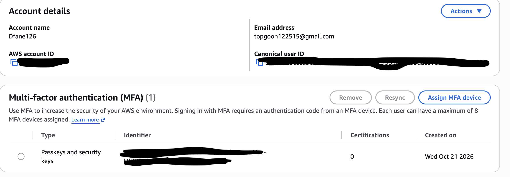
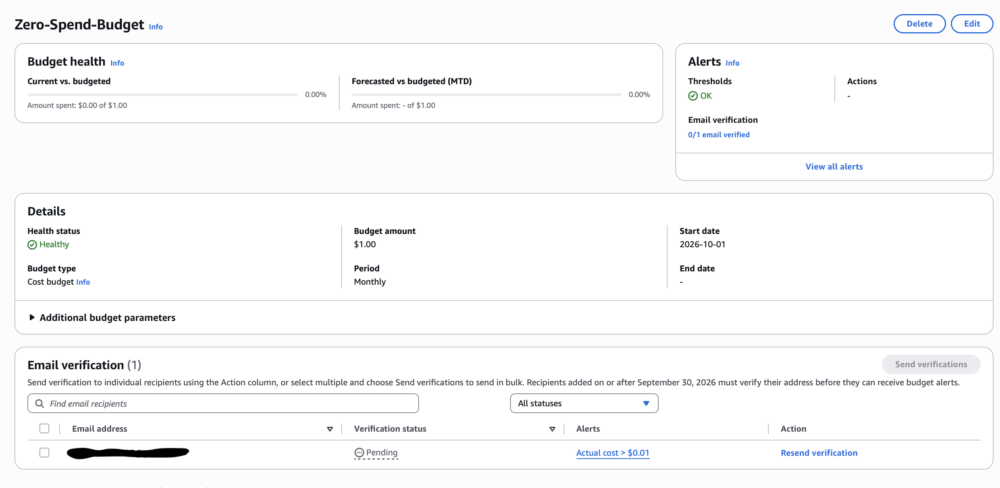
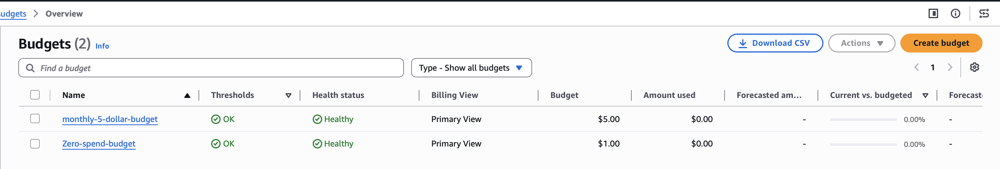
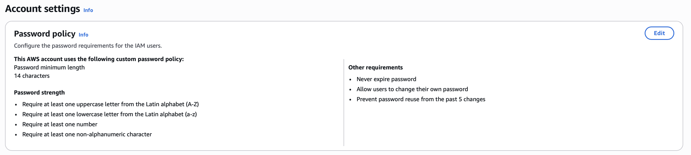
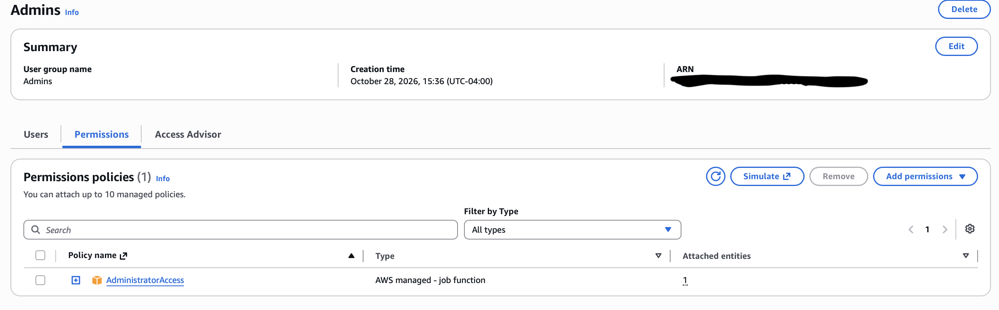
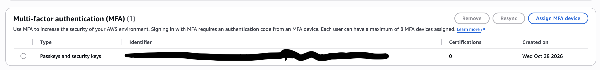

# Phase 1: Account Hardening

**Goal:** Before building anything, make the AWS account safe to use. By the end of this phase, the root user is locked away, a surprise bill isn't possible, and day-to-day work happens through a separate admin user protected by MFA.

**Status:** In progress <!-- Change to "Complete" on Day 5 -->

## Controls summary

<!-- Fill in the Evidence column as you finish each control. -->

| # | Control | Why it matters | Evidence |
| --- | --- | --- | --- |
| 1 | MFA on the root user | Root has unlimited power and can't be restricted | `screenshots/01-root-mfa.png` |
| 2 | Zero-spend budget | Alerts on any unexpected charge | `screenshots/02-zero-spend-budget.png` |
| 3 | $5 monthly cost budget | Second cost safety net | `screenshots/03-monthly-budget.png` |
| 4 | Strict IAM password policy | Stops weak passwords for any IAM user | `screenshots/04-password-policy.png` |
| 5 | Admin access through a group | Permissions are easy to review and remove | `screenshots/05-admins-group.png` |
| 6 | MFA on the admin user | Protects the identity used every day | `screenshots/06-admin-mfa.png` |
| 7 | No access keys for root or admin | No long-lived secrets that can leak | `evidence/account-summary.txt` |
| 8 | Security alternate contact | AWS can reach me about security issues | `screenshots/07-security-contact.png` |

## 1. Locking down the root user

10/26/26 8:00PM

- My passkey MFA: I registered a passkey that unlocks with my fingerprint for convenience but also for the security of my physical presence being a must to unlock my account
- My Access Key: I decided not to use access keys thanks to the root user

- My notes: In this situation I realized the danger of having a root user that controls all my systems which is of course a minus from the convenience of it. So the first idea that came up to help secure my root user is a fingerprint passkey which I believe is a reliable security method thanks to the necessity of the owners physical presence.

## 2. Billing guardrails

10/27/26 8:04PM

2 budgets were made today:
- My zero spend budget: Created with the purpose of being a system that alerts my email in case of a purchase.
- My $5 monthly budget: Created with the purpose of alerting my email if the time comes where I run out of free credits.

- My notes: In this situation it felt like a security situation where I just made my own security control against any unnecessary/unwanted purchases. In this case the cost alerts being my security controls. In this case the unnecessary purchases can be seen similar to a scenario where hackers (AWS) attack my bank's institution to steal my funds. 

## 3. A separate admin identity

10/28/26 4:01 PM

I have decided to transition from using a root user for login all the time and have created:
- A Password policy: To maximize the obscurity of the password, I added as much complex policies as I could including but not limited to: minimum 14 characters, upper and lower case numbers, and etc.
- An Admins group: Created with administration access policy
- An IAM User: for my user just kept it simple, "Steven-admin"

- My notes: A reason for my switch to a IAM user and what kind of prompted me to do this is the IAM user's longevity for credentials. Unlike something like a IAM identity center where the credentials are temporary and only lasts for a few hours, a IAM user is just the same credentials until either changed or deleted, making it a simple, but trustable access way. 

## 4. Verifying from the command line

10/29/29 4:42 AM

I used AWS cloud shell which led me to realize I never needed access keys on my MacBook. During my journey of AWS cloud shell, I ran 7 checks on the security settings of my AWS account. My real account id was replaced with "123456789012".

- My notes: Today, I realized the importance of the sed part of the script when I did my checks on cloud shell. Thanks to my sed step, my account id was kept safe from public view also keeping my project and future projects safe. And the grep -c retiring 0 proves this. 

Full output: [`evidence/`](evidence/)

## What I learned

<!-- Day 5 -->

- [Biggest takeaway]
- [Something that was harder or different than expected]
- [What you'd do differently in a real company]

## Next

Phase 2: turning on CloudTrail, GuardDuty, AWS Config, Security Hub, and IAM Access Analyzer.
