# Phase 2: Detection

Phase 1 locked the account down. Phase 2 makes sure that if something goes wrong anyway, I can see it. 

## 1. CloudTrail 

11/1/26 10:20PM

Before setting up the trail, I looked at CloudTrail's Event History. It already showed my Phase 1 work (`CreateUser`, `CreateGroup`,
`UpdateAccountPasswordPolicy`). But Event history only keeps 90 days and can't be changed, so I created a trail to keep a copy of the logs in
storage I control.

However, today a problem occurred during my testing of alerts. I logged in with the correct IAM user but not the correct password twice to trigger false login alerts within my console. However, after I did that and logged into my console with the correct credentials, I checked my console login event history but found none of the correct signals I was supposed to receive, to let me know my console successfully sends login alerts. Tomorrow, I will continue with this investigation to find out why.

 

## 2. Cloudtrail region investigation

11/2/26 1:09PM

Ran this code i found for cloudshell to investigate the failed investigation on my failed login. After investigating I found that the issue lay in the region of my aws console. 

- code: checks every region for consolelogin events. After running it in cloudshell, I discovered my IAM logins to be all hidden in the US east 2 region. So unlike my previous premonition where I thought I couldn't find my event history due to my event logs just not showing anything for IAM logins it was more just of a region issue. 
- cloudtrail: finally found the failed login attempts at November 1 9:13 pm after switching region to US east 2
- cloudtrail: also found my successful login at November 1 9:14 pm which upon analyzing both the successful and unsuccessful login attempts' JSONs, there were obvious differences.

## 3. Multiregion trail 

11/3/26 3:38PM

Ran a code in cloudshell that showed all my past history of console logins. From here, I really compared all my past logins which showed the success of my console as I noticed hints such as my one ip address being prevalent in the ip section, a prevalent user id and the response.elements matching what happened compared to the time of the event. Then, I went to cloudshell to create a new trail. This time, however, to fix how the previous trail only logged events in US east 1, I made this region a multi region trail. 

11/4/26 5:56 PM

Today, I attempted to prove my trail works only to come upon a new problem. Creating a new login event, I looked for it in my S3 bucket and found its S3 URI. But upon adding my S3 URI to my cloudshell terminal with my code that would have shown me my eventTime, user, etc. nothing popped up. Unfortunately I have a headache unabling me to pursue the root of this problem further. 

11/5/26 2:10 PM

To recap on why the code wasn’t working yesterday, I am now reinserting the code and adding my S3 URI into cloudshell. This time, something did produce: (1: GetBucketAcl). This is good news and bad news. Good news: it proves that my cloudshell is still actually logging events. Bad news: I logged into my aws in the hour of 15:00UtC but no other event in that hour is a log in event meaning either I logged into the wrong region that day or my system can’t catch log in events. So with further research, I discovered another code that wouldn’t go just through US east 2 region but every region’s events for Nov 4. But upon entering the code, nothing popped up again. Which upon research, showed me there’s no console login for any region during Nov 4. Which I will tackle tomorrow. 

11/6/26 6:49 PM

To tackle what went wrong yesterday, today I deployed a number of odes. First, to directly tackle the big question of if my seclab-trail is even working, I deployed a code that thankfully gave me an output table proving it does. Then, I deployed another code that discovers if my trail is multiregion and which bucket it answers to, which also thankfully showed me it’s multiregion and reports to the right bucket. So to confirm my last suspicion of if the nov 4 login event was even logged somewhere, I deployed my last code which also thankfully showed me the nov 4 login event I was looking for with the right time to it too. Tomorrow, I will add the S3 UCI and code to cloudshell again and see if this time finally will produce something. 

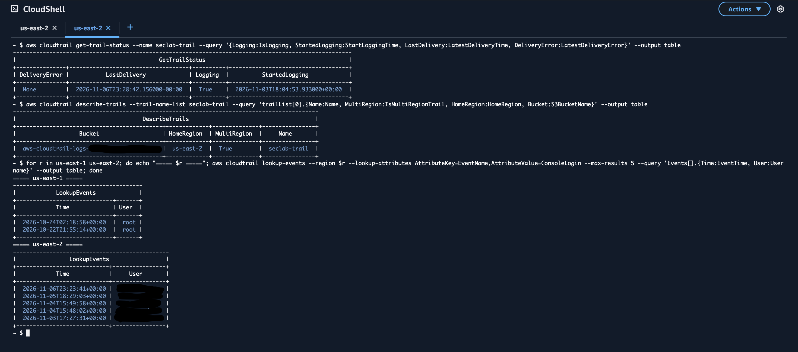

11/9/26 9:51 PM

Today, I did my final checkup on the S3 bucket to see if it will finally produce my login event on cloudshell after inputting my S3 URI of the event. After my initial login, I logged out again at 8:20 PM and waited 15 minutes for my console to register the event. Then, I added a code that shows every console event during a 3 hour window before I added the code. The code showed me my specific log in event with my S3 URI of the event, which I copied and then used to do my final check of if my cloudshell will finally give me my login event details from the URI and code, proving my seclab-trail does actually records and stores my logins in S3. Finally, I added another code in cloudshell to check if my cloudwatch login groups caught the login event as well, which it proved to do. 

While checking my work, I realized I’ve made a very rookie and foolish mistake. A lot of the times I would look for event timestamp when I should’ve been looking at the creation date/event time of the event. Although, I’m not too sure if this same mistake applies for cloudshell events and etc. but I will keep this in mind now. The new screenshot of the cloudwatch log events is my real log in event. 

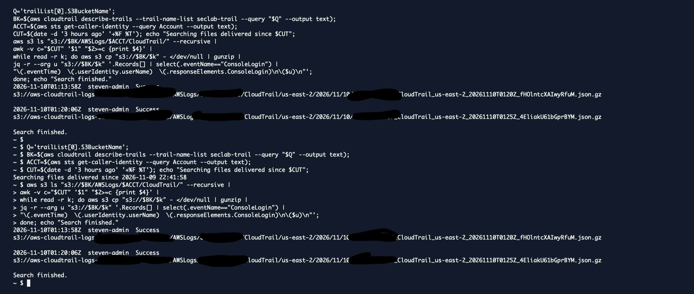
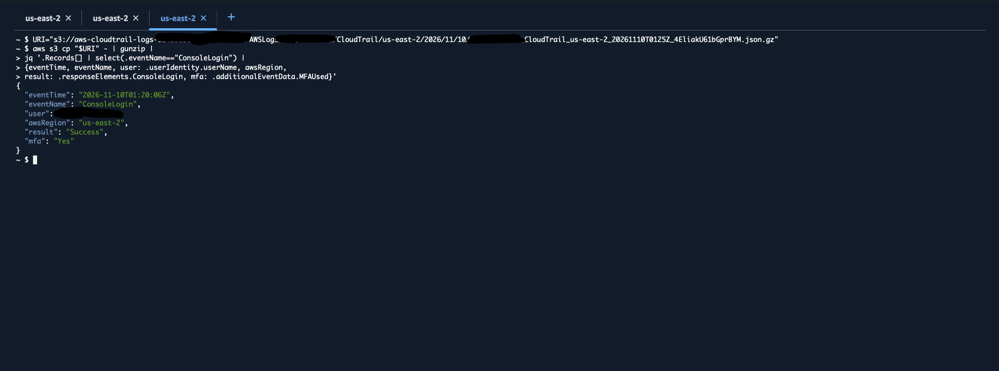
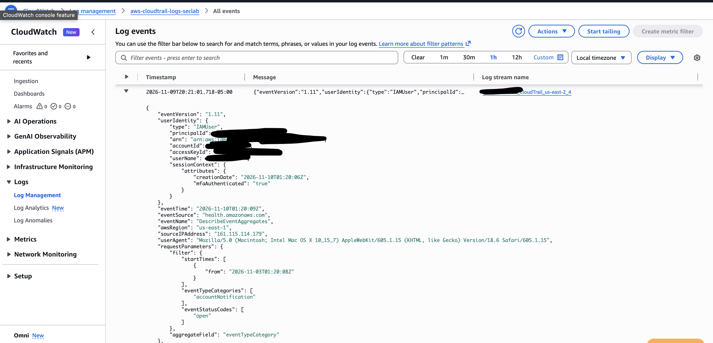
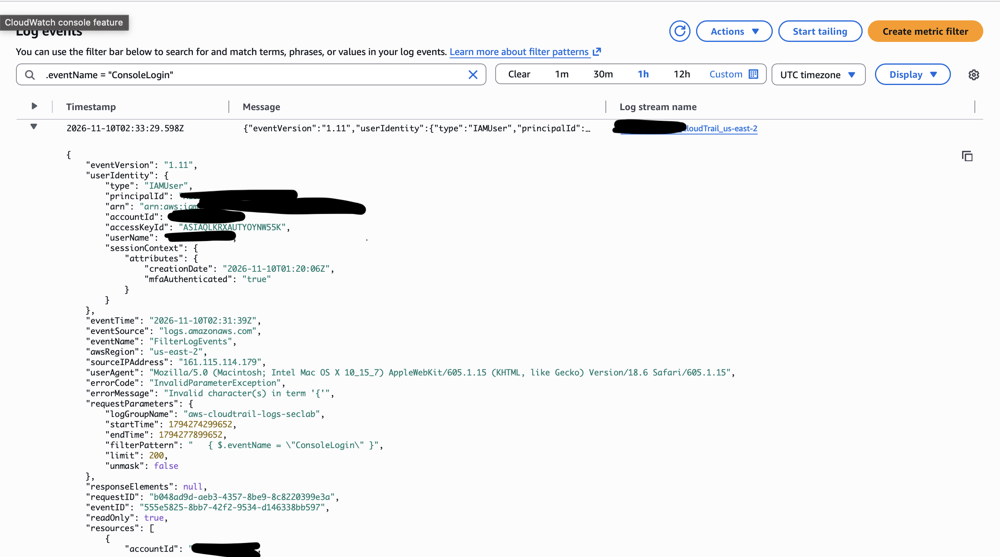

11/10/26 10:44 PM

Today, I worked on improving my cloudwatch by first adding a Filter pattern to my metric filter. Then, adding more metric details, I created a new metric filter to my cloudwatch. Thus, now thanks to my metric filter, my cloudwatch immediately filters cloudshell events to point out the failed logins. Next, to add even more security to my cloudwatch, I’ve created an alarm that will immediately alert my email for these discovered failed logins. Tomorrow, I will be orchestrating a failed login in my console and confirm if my alarm is working. 

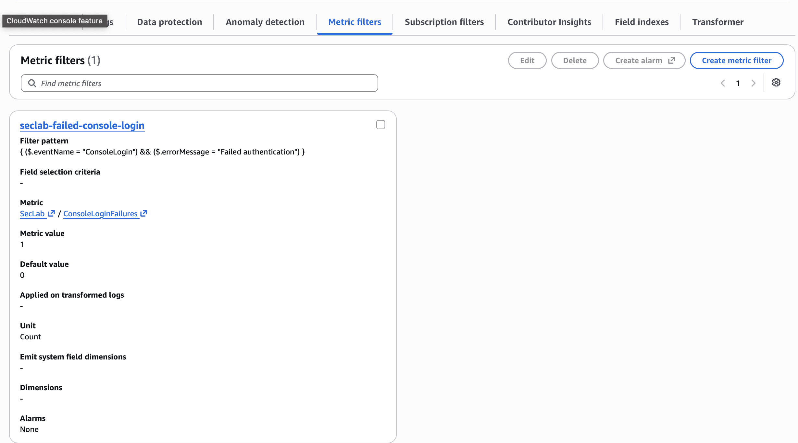
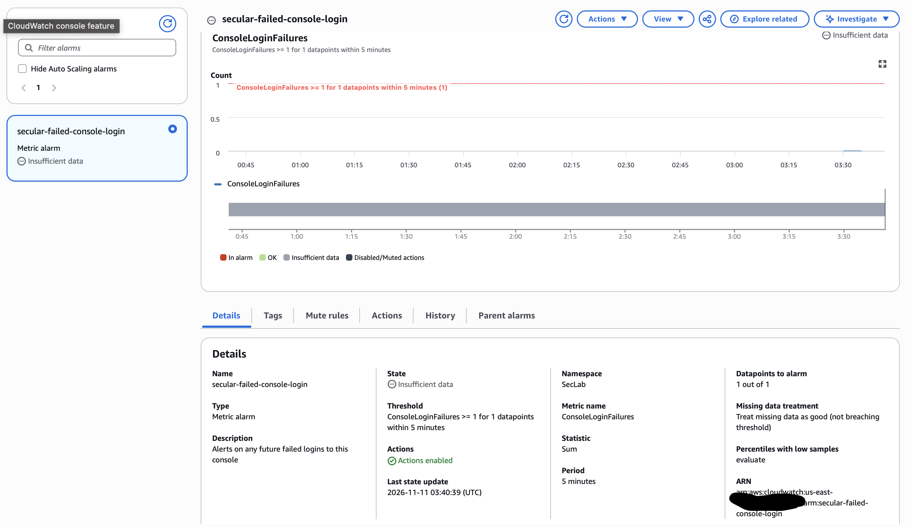

11/11/26 5:14 PM

Today, I worked on creating my root metric filter. While the metric filter last time was for my IAM user sign ins, this metric filter will be used to detect any unusual activity/denied sign ins for my root user. Then, after creating the root metric filter, of course, created an alarm alongside it, as a filter without an alarm is almost useless. Creating the alarm, I’ve added nearly the same modifications to it as my alarm for my IAM user. Tomorrow, I will be logging out and testing both my IAM user and root user alarms and see if either and hopefully both, will send me an email about the failed log in. 

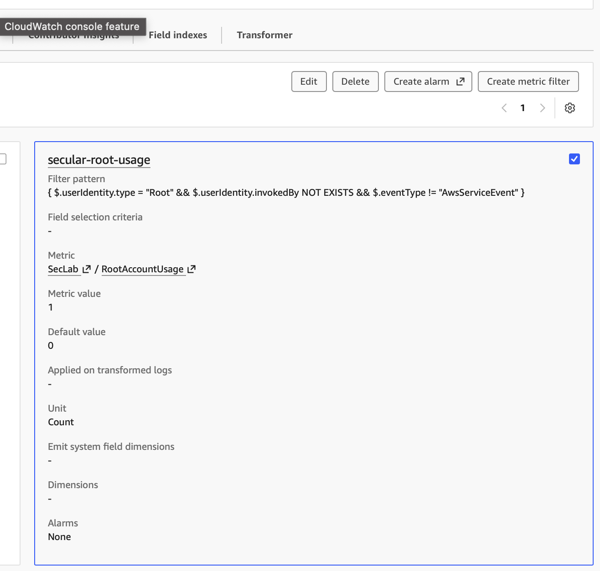
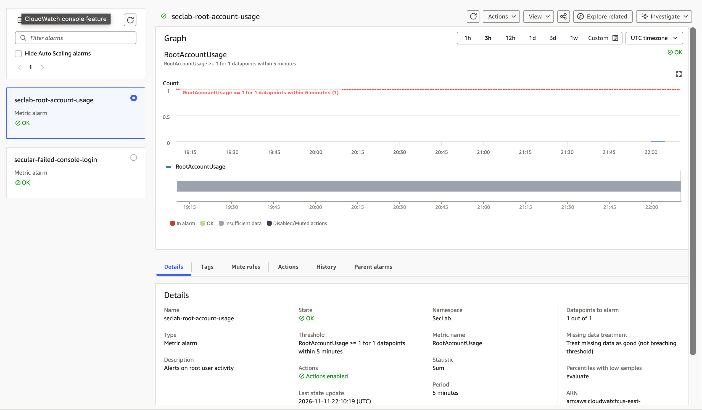

11/12/25 6:19 PM

Today, I tested both the alarms for my IAM user and root user. At 5:07 PM I signed in to my IAM user 2 times with the wrong password. Then, at 5:09 PM I also signed in to my root user 2 times with the wrong password. After waiting 10 minutes to let the console process the failed log in, I checked the email connected to my aws alarms, and thankfully found both alarms being rung and the reports in my email. 

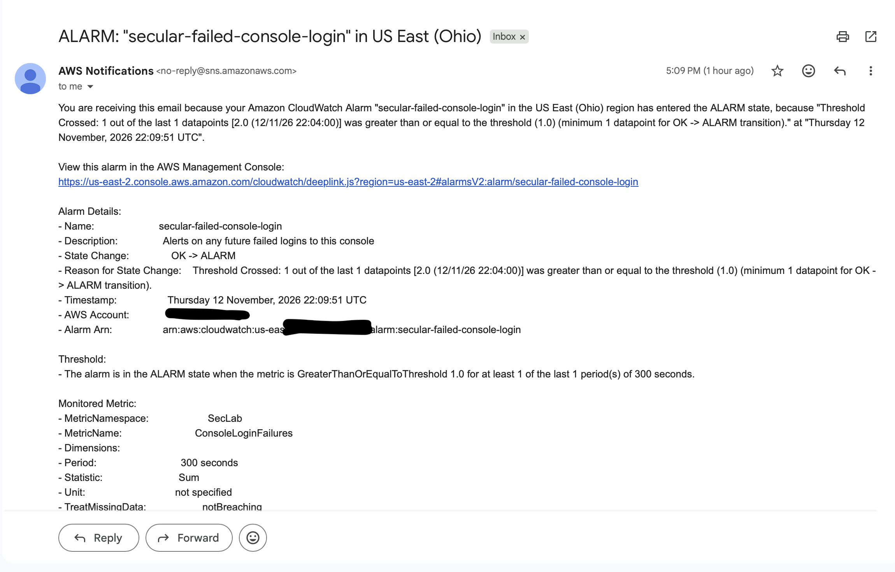
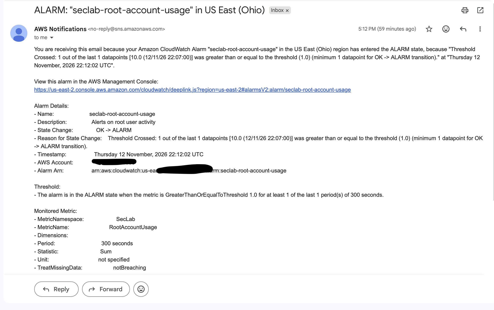

11/13/26 5:16 PM

Last time, we created both an alarm for the failed logins for both my IAM and root user. But to add to the security of my console, I’ve created another alarm. This time, to alert me of any changes to my IAM console permissions. First, of course I created my IAM change metric filter. Then, adding my lab email to the alarm, created it. Then, I tested my alarm by going to my IAM and adding a miscellaneous policy (seclab-test-policy) and deleting it. Thankfully, I received the alert in gmail proving my alarm works. 

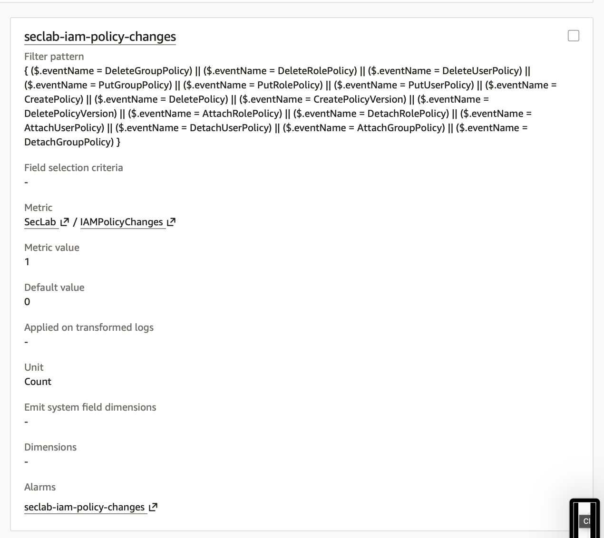
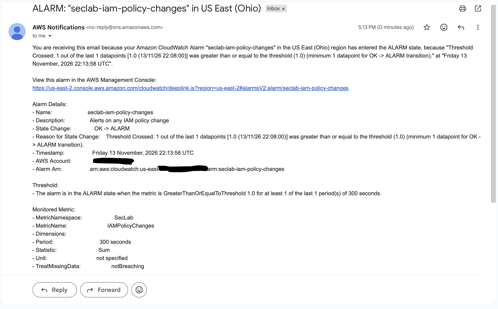
