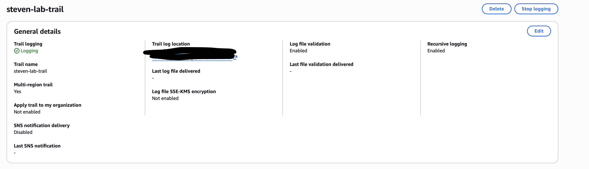
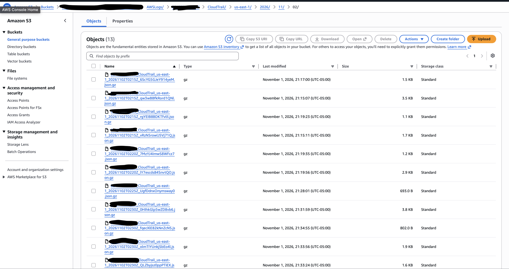
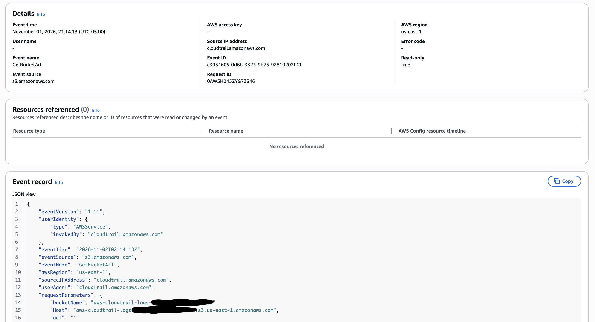
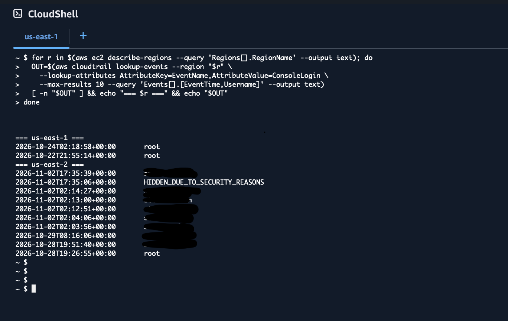
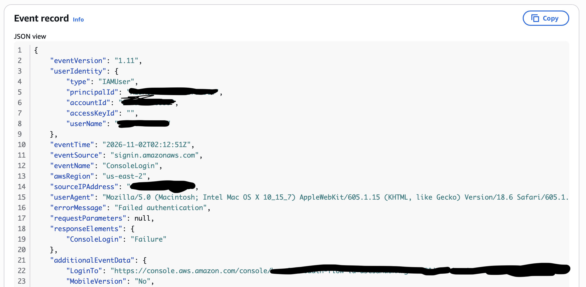
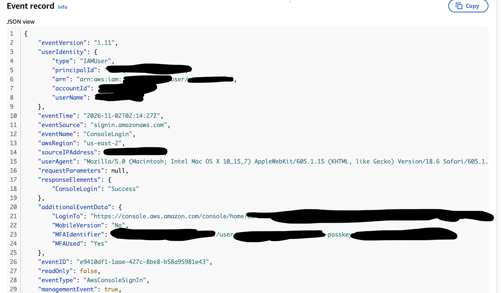
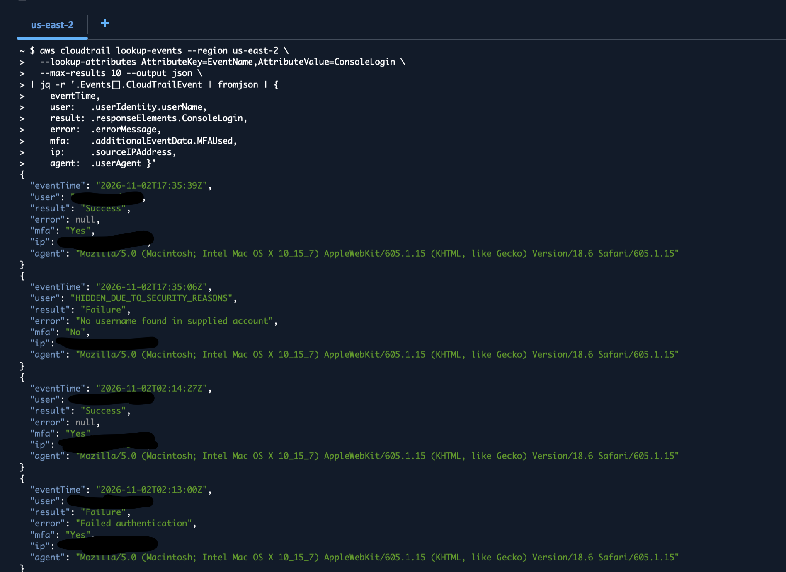
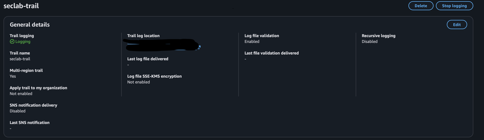
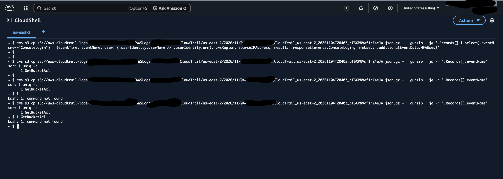
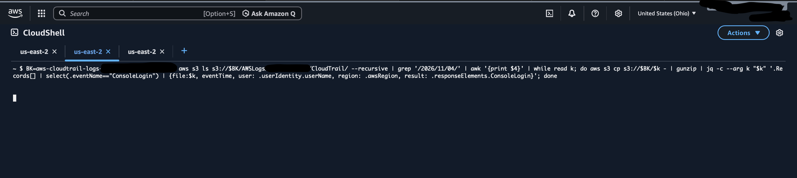

# Phase 2: Detection

Phase 1 locked the account down. Phase 2 makes sure that if something goes wrong anyway, I can see it. 

## 1. CloudTrail 

11/1/26 10:20PM

Before setting up the trail, I looked at CloudTrail's Event History. It already showed my Phase 1 work (`CreateUser`, `CreateGroup`,
`UpdateAccountPasswordPolicy`). But Event history only keeps 90 days and can't be changed, so I created a trail to keep a copy of the logs in
storage I control.

However, today a problem occurred during my testing of alerts. I logged in with the correct IAM user but not the correct password twice to trigger false login alerts within my console. However, after I did that and logged into my console with the correct credentials, I checked my console login event history but found none of the correct signals I was supposed to receive, to let me know my console successfully sends login alerts. Tomorrow, I will continue with this investigation to find out why.

 

## 2. Cloudtrail region investigation

11/2/26 1:09PM

Ran this code i found for cloudshell to investigate the failed investigation on my failed login. After investigating I found that the issue lay in the region of my aws console. 

- code: checks every region for consolelogin events. After running it in cloudshell, I discovered my IAM logins to be all hidden in the US east 2 region. So unlike my previous premonition where I thought I couldn't find my event history due to my event logs just not showing anything for IAM logins it was more just of a region issue. 
- cloudtrail: finally found the failed login attempts at November 1 9:13 pm after switching region to US east 2
- cloudtrail: also found my successful login at November 1 9:14 pm which upon analyzing both the successful and unsuccessful login attempts' JSONs, there were obvious differences.

## 3. Multiregion trail 

11/3/26 3:38PM

Ran a code in cloudshell that showed all my past history of console logins. From here, I really compared all my past logins which showed the success of my console as I noticed hints such as my one ip address being prevalent in the ip section, a prevalent user id and the response.elements matching what happened compared to the time of the event. Then, I went to cloudshell to create a new trail. This time, however, to fix how the previous trail only logged events in US east 1, I made this region a multi region trail. 

11/4/26 5:56 PM

Today, I attempted to prove my trail works only to come upon a new problem. Creating a new login event, I looked for it in my S3 bucket and found its S3 URI. But upon adding my S3 URI to my cloudshell terminal with my code that would have shown me my eventTime, user, etc. nothing popped up. Unfortunately I have a headache unabling me to pursue the root of this problem further. 

11/5/26 2:10 PM

To recap on why the code wasn’t working yesterday, I am now reinserting the code and adding my S3 URI into cloudshell. This time, something did produce: (1: GetBucketAcl). This is good news and bad news. Good news: it proves that my cloudshell is still actually logging events. Bad news: I logged into my aws in the hour of 15:00UtC but no other event in that hour is a log in event meaning either I logged into the wrong region that day or my system can’t catch log in events. So with further research, I discovered another code that wouldn’t go just through US east 2 region but every region’s events for Nov 4. But upon entering the code, nothing popped up again. Which upon research, showed me there’s no console login for any region during Nov 4. Which I will tackle tomorrow. 

